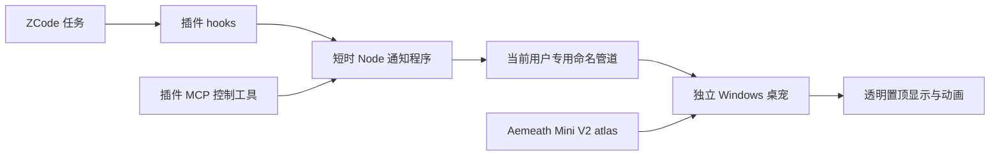

# Codex 宠物迁移到 ZCode：源码核查与接入边界

核查日期：2026-09-30。本机 Codex 26.928.1915.0、ZCode 3.14.4。

## 结论与实现选择

可以复用 V2 素材协议，在 ZCode 插件中通过 hooks 驱动独立桌宠窗口，并通过 MCP 提供显示、隐藏、退出和配置工具。ZCode 插件当前不是 Electron UI 扩展，因此原生透明窗口由独立 companion 实现。

现有插件事件只覆盖部分生命周期，不能精确复制 Codex 的全部任务通知、审批、聊天入口、后台任务与未读状态。若要完整同步取消、网络失败和权限解决，需要可编辑的 ZCode 宿主提供正式事件订阅 API。

本项目自行实现窗口与桥接，没有复制 Codex/ZCode 产品代码，没有修改安装包。参考的是本机产品构建代码；未拿到独立原始源码仓库。ASAR 内没有可用 source maps 或 repository 信息，不能把本次静态核查称为原始仓库源码验证。

## 数据流

聊天正文、工具参数、工具结果和 transcript 路径不发送给窗口。会话关联键只发送 SHA256 哈希，桥接不写任务内容日志。

## Codex 当前实现证据

安装包：`C:\Program Files\WindowsApps\OpenAI.Codex_26.928.1915.0_x64__2p2nqsd0c76g0\app\resources\app.asar`

| 包内位置 | 符号 | 已确认实现 |
|---|---|---|
| `.vite/build/main-BGDKyzfM.js` | `tce.createWindow`、`z9`、`R9` | 独立 BrowserWindow，透明、无边框、无阴影、置顶、跳过任务栏、不抢焦点 |
| 同上 | `applyPointerInteractivityPolicy`、`applyInputShape` | 局部命中区域；退化为 setIgnoreMouseEvents 的事件转发 |
| 同上 | `startDrag`、`moveDrag`、`endDrag` | 保存抓取偏移，屏幕坐标移动，多屏约束及位置持久化 |
| `webview/assets/app-initial-7e7a15e7e995.js` | `Mza`、`qza`、`Bza`、`Yza` | atlas 背景定位、单帧时序、减少动态效果、16方向 |
| `webview/assets/avatar-overlay-native-page-3ceef223ec4c.js` | `$p`、`nm`、`am`、`dd` | 任务状态归一化与聚合：等待 > 失败 > 完成 > 工作 > 空闲 |
| `.vite/build/bootstrap-Bj_1Kfw1.js` | `aB`、`oB`、`dB`、`cB`、`fB` | 本地素材读取、路径/格式/尺寸验证 |
| `.vite/build/preload.js` | `electronBridge` | renderer/main IPC；不作为 ZCode 插件接入协议使用 |

V2 atlas 为1536×2288、8列×11行、每格192×208。九行动画有效帧数 `[6,8,8,4,5,8,6,6,6]`，最后两行是16个顺时针观察方向。

当前 Codex idle 基础时长 `[280,110,110,140,140,320]` ms，在播放器中乘6，一轮6.6秒。新版播放器有 loop 参数，但桌面 wrapper 未传，非idle仍默认播三轮后进入idle。本插件使用基础时长，工作/等待持续循环，并提供0.5–2倍调速。这改变播放节奏，不增加中间帧，不能宣称30/60帧角色动画。

官方功能背景：[Pets 文档](https://learn.chatgpt.com/docs/pets?surface=app)。本轮通过浏览器实际读取该页；它支持浮动窗口、拖动、任务状态和减少动态效果的产品描述，具体内部接口结论来自安装包核查。

## ZCode 插件实现证据

- `F:\ZCode\resources\app.asar`：`@zcode/desktop` 3.14.4；private package，无 repository。
- `F:\ZCode\resources\glm\zcode.cjs`：插件适配和实际 agent runtime 构建代码。
- `F:\ZCode\resources\glm\packages\plugin-creator-plugin\skills\plugin-creator\references\plugin-json-spec.md`：`.zcode-plugin/plugin.json`、组件、路径变量和本地 marketplace 格式。
- 同目录 `installing-and-updating.md`：实际安装入口为插件市场添加本地目录，再在 Personal 安装；源目录存在不等于已安装。

关键 runtime 符号：`NodePluginAdapter`、`listPluginHookSources`、`createClaudeCompatibleHookStdin`、`createConfiguredHookCallback`、`mergeRuntimeHooks`。

插件支持 skills、commands、stdio MCP 和 hooks，没有公开 BrowserWindow API。process hook 使用 command + argv，不经 shell，stdin 为 JSON 加换行；`${ZCODE_PLUGIN_ROOT}` 指向实际安装根目录。非空插件 hooks 会自动合并启用。本项目使用非默认文件 `hooks/pet-events.json`，避免同一 hooks 文件重复发现。

## 事件映射与准确性

| 实际 hook | 本插件显示 | 边界 |
|---|---|---|
| SessionStart | 准备/显示宠物，idle | 每会话首次 startup/resume，不是每轮任务开始；遵守用户隐藏/退出选择 |
| UserPromptSubmit | running | 常规用户 turn 开工 |
| PreToolUse | running；AskUserQuestion 显示 waiting | 等待输入是工具前通知的近似映射 |
| PermissionRequest | waiting | 可能与其他 hook 自动审批竞速，不代替用户审批 |
| PostToolUse | running | 工具结束，不代表整个任务完成 |
| PostToolUseFailure | failed 反馈 | 工具失败，不代表整轮失败 |
| Stop | review 反馈 | 正常收尾前通知，不是完整成功事件 |

`runStopHooks` 的实际调用在 `finishModelStepWithoutToolCalls`；`appendTurnOutcomeEvent` 写取消/TurnError 时不触发 Stop。插件没有 SessionEnd、AppClose、卸载事件。内部 `session/subscribe` 走桌面持有的私有 app-server stdio 子进程，另起进程不能订阅现有会话。

本版以会话为粒度聚合；同一会话中并行工具的等待/恢复事件可能覆盖彼此。网络错误、鉴权失败和手动取消缺少可靠事件，不能保证即时恢复。30分钟无状态更新的会话会被显示租约回收，status 中计入 expiredSessions；这是防止失联状态永久占位的显示策略，不是任务完成证据。review反馈30秒、工具失败反馈5秒后移除。

## 验证边界

素材全图 RGBA 一致性已通过。Node bridge 的真实子进程 stdio、模拟命名管道、事件过滤和输入拒绝有自动化验证。原生程序已编译，但首次隔离执行及未沙箱重试返回 Access denied，文件随后不再存在；没有匹配证据证明具体拦截产品，未改变安全设置/ACL。

因此实际透明窗口、命中/拖动、多屏、宿主退出清理、原生管道端以及 ZCode 中真实 hooks 联动待验收。没有声称市场已添加、插件已安装或桌面运行成功。
